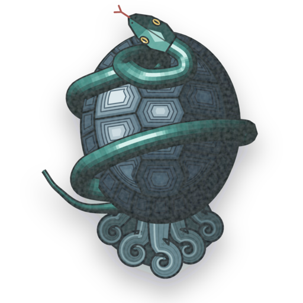

<p align="center">
  
</p>

# Genbu Show

Firmware for unlocked Amazon Echo Shows. Android and Alexa go; a small Alpine Linux image and one Go
daemon (`echod`) take their place, and the Show becomes a Home Assistant voice satellite with a touch
screen. Home Assistant is in charge of everything: the voice pipeline, the screen, updates.

Genbu Show is a fork of [TECHO5](https://github.com/HuskerMinion/techo5), which did the hard part of
getting Linux onto these devices. This fork adds a Home Assistant integration (Genbu Assistant), its own
installer, a board catalogue and its own signed release channels.

The code and many docs still say **Jarvis Show**, the project's first name: `tools/jarvis-show.py`, the
`/jarvis-display` dashboard route, `/etc/jarvis-show-release.json` on the Show. It is the same thing.

## Boards

All three run the same daemon and the same root filesystem. The boot image, the unlock payload and TWRP
are per board and are never mixed. Which boards a release covers comes from the board catalogue,
[`catalogue/products/genbu-show-v1.json`](catalogue/products/genbu-show-v1.json).

| Board | Device | Model | Where it stands |
|---|---|---|---|
| `crown` | Echo Show 8, 1st gen (2019) | C7H6N3 | Installs end to end; unlock hashes built in |
| `checkers` | Echo Show 5, 1st gen (2019) | H23K37 | Installs end to end; the unlock wants its hashes passed in (`--amonet-hashes`) |
| `cronos` | Echo Show 5, 2nd gen (2021) | C76N8S | In the catalogue; the unlock wants `--amonet-hashes`, and the install needs a release whose root filesystem lists cronos |

[docs/board-catalogue.md](docs/board-catalogue.md) explains the catalogue and what is still open per
board; [docs/board-catalogue-evidence.md](docs/board-catalogue-evidence.md) has what each fact rests on.

## Install

The installer runs on Linux with Python 3.10+, `adb`, `fastboot`, `git`, `bash` and GNU `timeout`, and
needs the serial console (`dialout` or `uucp`). Connect one Show on mains power, then:

```sh
python3 tools/jarvis-show.py preflight
python3 tools/jarvis-show.py install --name <name>
```

`preflight` checks the computer and the input files and touches no Show. `install` works out the board,
fetches the pinned LineageOS zip and boot image, unlocks with Amonet if the Show is still locked, makes a
recovery backup, and checks the boot image, root filesystem and backup before it erases anything. It asks
before every write. At the end it adds the Show to Home Assistant as an ESPHome device, lets you pick the
assistant and wake word, and sets up DashCast and Music Assistant.

- [docs/jarvis-show-runbook.md](docs/jarvis-show-runbook.md): the install, step by step.
- [docs/jarvis-crown-installer.md](docs/jarvis-crown-installer.md): every gate, command and switch,
  taking a Show out again, and finding Shows.
- [docs/one-command-installer.md](docs/one-command-installer.md): the order of the safety gates.

`tools/install-show.py` is upstream TECHO5's installer and is still here, but `jarvis-show.py` is the one
this fork's releases are made for.

## Genbu Assistant

A Home Assistant integration, in [`ha/custom_components/genbu`](ha/custom_components/genbu). Copy that
folder to `/config/custom_components/genbu/` on Home Assistant and restart it; the installer adds the
integration from there. It gives the house one place for its Shows:

- **Updates.** Genbu Assistant reads the release channel once for the whole house and offers one update
  card, *Genbu Show firmware*. Every Show follows it, so they stay on the same version and don't each ask
  about an update.
- **Genbu Control Center.** A page in the sidebar with a card for the house and one per Show, in groups
  that fold away, with each Show's own automations and a switch per Show for each optional feature.
- **The assistant.** The wake word runs on the Show (Okay Nabu by default), the voice pipeline in Home
  Assistant. When the house's assistant is a language model, Genbu gives it a tool for the Shows'
  firmware, so "update yourself" works however it is said.

[docs/genbu-assistant.md](docs/genbu-assistant.md) has the design and what was decided;
[docs/update-leader.md](docs/update-leader.md) has how updates work across the house.

## Updates and channels

Releases are signed with an Ed25519 key, and a Show takes only what that key signed
([docs/ota-identity.md](docs/ota-identity.md)). A Show installs into the spare of two root filesystem
slots, boots it on trial and falls back by itself when it doesn't settle.

There are three channels. Genbu Assistant has one channel for the whole house; a Show without it follows
its own channel setting.

| Channel | Branch | Release names |
|---|---|---|
| stable | `stable` | `vX.Y.Z-stable.N` |
| staging | `staging` | `vX.Y.Z-staging.N` |
| dev | `dev` | `vX.Y.Z-dev.N` |

A push to one of those branches tests, builds, signs and publishes a release on its channel. Work goes
dev, then staging, then stable.

- [docs/ota-channels.md](docs/ota-channels.md): how the channels serve updates and how versions rank.
- [docs/release-pipeline.md](docs/release-pipeline.md): what a release contains and how it is made.
- [docs/WORKFLOW.md](docs/WORKFLOW.md): branches, from a task to stable.

## What's in the repository

| Path | What |
|---|---|
| `echod/` | The daemon: audio, wake word, echo cancellation, screen, touch, camera, Bluetooth, updates, the ESPHome API |
| `ha/` | Genbu Assistant, with its tests |
| `dashcast/` | Streams Home Assistant dashboards to the Show's screen ([dashcast/README.md](dashcast/README.md)) |
| `catalogue/` | Products and boards, and the pins for each board's files |
| `tools/jarvis-show.py`, `tools/jarvis_crown/` | The installer |
| `tools/linux/` | The root filesystem and boot image tooling ([tools/linux/README.md](tools/linux/README.md)) |
| `tools/release-jarvis-show.sh` | Signs and publishes a release |
| `docs/` | Design notes, runbooks, acceptance lists |

## Tests

```sh
python3 -m unittest discover -s tests -p 'test_*.py'
(cd echod && go vet ./... && go test ./...)
python3 tools/board_names.py          # no board names creep back into code
python3 tools/secret_scan.py --here   # before every push
```

`ha/tests` runs under `pytest` with `pytest-homeassistant-custom-component`. CI runs the checks on every
`feature/`, `task/` and `fix/` branch.

## Upstream and credits

Genbu Show is TECHO5 underneath, and TECHO5 started from
[EchoLocal](https://github.com/ygelfand/echolocal) by Yuri Gelfand, which turned the Echo Dot 2 into an
ESPHome satellite with a single Go daemon. Most of what makes a Show run under Linux is their work.
TECHO5's credits, as upstream lists them:

**The path here**
- [EchoLocal](https://github.com/ygelfand/echolocal) (MIT, Yuri Gelfand): the daemon TECHO5 is built
  on, and [go-esphome-device](https://github.com/ygelfand/go-esphome-device), the ESPHome device API it
  speaks.
- **amonet-cronos and kaeru** (k4y0z, [R0rt1z2](https://github.com/R0rt1z2)): the bootloader unlock
  and recovery that make any of this possible.
- [@proffalken](https://github.com/proffalken): the
  [step-by-step install from Linux](https://gist.github.com/proffalken/377ae50146affe1886dddaaacb87926b)
  that TECHO5's [Getting started](docs/getting-started.md) and cross-platform installers are based on.
- **LineageOS 18.1 for `cronos`** (unofficial, R0rt1z2), built on
  [Amazon's GPL kernel source](https://github.com/amazon-oss/android_kernel_amazon_mt8163): the
  kernel TECHO5 rebuilds and the vendor drivers it keeps. [TWRP](https://twrp.me/) stays as the way back.
- ShowAssist and the
  [View Assist Companion App](https://github.com/msp1974/ViewAssistCompanionApp) (Mark Parker): what
  ran the Show before TECHO5, and the first proof it could be a Home Assistant satellite.
- [jxlarrea/lineageos-echo-show-camera](https://github.com/jxlarrea/lineageos-echo-show-camera):
  the OV02B10 camera driver and sensor fixes, the privacy latch, and echo cancellation work on the
  Echo Show family.
- [bengris32/linux-mtk](https://github.com/bengris32/linux-mtk): the mainline MT8163 effort, a map of
  the hardware.
- The BQ Aquaris E10 GPL source release: MediaTek's ISP register map for this chip generation, which
  let the camera run from userspace.
- [@Empty2k12](https://github.com/Empty2k12): the first hardware findings from an Echo Show 5 1st gen
  (`checkers`), including the recipe that made its speaker play, in
  [TECHO5 pull request #2](https://github.com/HuskerMinion/techo5/pull/2).
- [@JonGilmore](https://github.com/JonGilmore): every 1st gen build tested on a real unit, two days of
  it. The microphones, the mute latch cutting their power, the camera and the spoken replies were all
  found or confirmed from what he reported.

**What runs on the device**
- [microWakeWord](https://github.com/kahrendt/microWakeWord) (Kevin Ahrendt), the
  [ESPHome wake word models](https://github.com/esphome/micro-wake-word-models), and
  [zserge/microwakeword](https://github.com/zserge/microwakeword) for Go.
- [Home Assistant](https://www.home-assistant.io/) and [ESPHome](https://esphome.io/): Assist, the
  native API, and the reason to build any of this.
- [Music Assistant](https://www.music-assistant.io/) and [Sendspin](https://github.com/Sendspin/sendspin-go).
- [Radio Browser](https://www.radio-browser.info/), through Home Assistant's integration, for stations
  near home.
- The rain map and weather alerts: the U.S. [National Weather Service](https://www.weather.gov/) for
  the radar and the [alerts](https://www.weather.gov/documentation/services-web-api) (public domain),
  with the radar's map tiles from the [Iowa Environmental Mesonet](https://mesonet.agron.iastate.edu/)
  at Iowa State University; [RainViewer](https://www.rainviewer.com/api.html) for the radar outside the
  U.S.; NASA's [GIBS](https://www.earthdata.nasa.gov/engage/open-data-services-software/earthdata-developer-portal/gibs-api)
  for the Blue Marble map and NOAA's GOES satellites' clouds; and
  [GeoNames](https://www.geonames.org/) (CC BY 4.0) for the town names.
- [Alpine Linux](https://alpinelinux.org/), BusyBox, Dropbear, wpa_supplicant, [BlueZ](https://www.bluez.org/),
  [bluez-alsa](https://github.com/arkq/bluez-alsa) (arkq), and
  [webrtc-audio-processing](https://gitlab.freedesktop.org/pulseaudio/webrtc-audio-processing).
- Go libraries: go-mp3 (Hajime Hoshi), godbus, gorilla/websocket, zeroconf, mewkiz/flac, pion/opus,
  cobra, viper, protobuf and the Go fonts; for calls, [diago](https://github.com/emiago/diago) and
  [sipgo](https://github.com/emiago/sipgo) (Emir Aganovic), [Pion](https://github.com/pion) SRTP and
  RTP, and zaf/g711.

[NOTICE](NOTICE) has the licenses of the code carried in this repository.

## License

GPL-3.0 or later, see [LICENSE](LICENSE). Anyone may use, change, share and sell it, as long as what
they pass on stays open under the same terms.

TECHO5 and EchoLocal are both MIT. Their code stays under their MIT licences, whose notices are in
[NOTICE](NOTICE) along with every other part's.

Genbu Show isn't affiliated with Amazon. Echo and Alexa are trademarks of Amazon.com, Inc.
